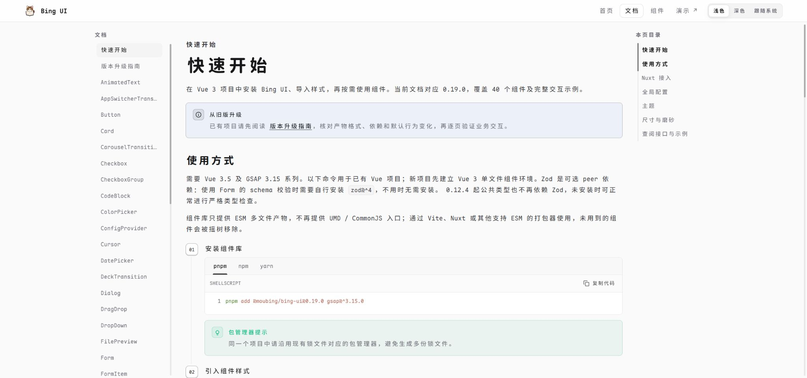
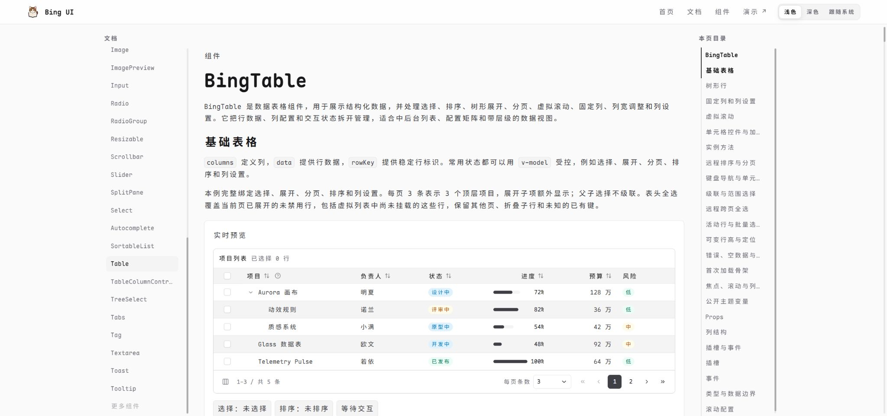
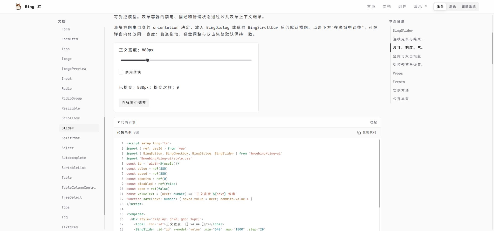
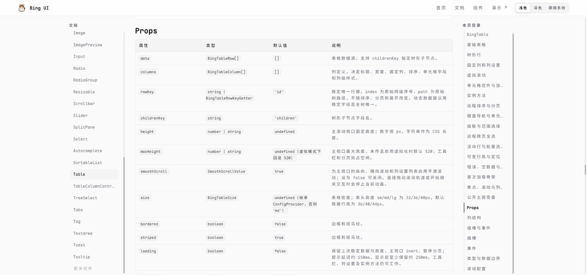

<p align="center">
  
</p>

<h1 align="center">Bing UI 文档站</h1>

<p align="center"><strong>从看见效果，到理解接口，再到写进自己的应用。</strong></p>
<p align="center">Nuxt 4 · Vue 3 · 交互式示例 · Markdown · AI 可读文档</p>

**[在线访问 · 使用文档](https://101.35.217.21:6008/docs)** · [Storybook 演示](https://101.35.217.21:6007/?path=/docs/components-binganimatedtext--docs) · [AI 文档](#ai-文档) · [相关项目](#相关项目)

`bing-ui-docs` 是 `@moubing/bing-ui` 的使用文档与交互演示站。它把项目介绍、快速开始、组件说明、参数面板、完整 Vue 示例和 API 参考放在同一个阅读流程中，帮助开发者了解组件、验证用法并复制到自己的项目。

同一份来源还会导出给 AI 编程助手阅读的文档：`llms.txt`、逐组件 Markdown 和带 SHA-256 的版本清单，导出的示例在独立应用中经过类型检查和浏览器验证。站点与导出工具由我独立开发。

<!-- docs:version:start -->
文档站本身也使用 Bing UI 构建。当前运行依赖固定为 **`@moubing/bing-ui@0.19.0`**，文档修订为 **r3**。
<!-- docs:version:end -->

[](docs/images/quick-start-production.jpg)

*生产文档站的快速开始页（2026-11-14）：集中说明版本、依赖和接入步骤，左侧切换组件，右侧定位章节。点击图片查看原图。*

[站点功能](#站点功能) · [设计要点](#设计要点) · [AI 文档](#ai-文档) · [文档与交互细节](#文档与交互细节) · [内容架构](#内容架构) · [本地运行](#本地运行) · [维护流程](#维护流程) · [验证](#验证)

## 站点功能

| 模块 | 可以做什么 |
| --- | --- |
| 项目首页 | 了解设计理念、复制安装命令、体验文字动效、控件与组合交互 |
| 快速开始 | 查看安装、样式引入、Vue / Nuxt 接入、主题和尺寸配置 |
| 组件文档 | 阅读行为说明、Props、事件、插槽、公开方法和使用边界 |
| 交互式示例 | 在页面内操作组件，通过支持参数面板的示例调整配置并查看生成代码 |
| 代码展示 | 查看高亮后的完整 Vue 单文件示例，直接复制用于自己的项目 |
| 文档导航 | 使用组件侧栏、本页目录和章节锚点，在长文档中定位内容 |
| 外观切换 | 在浅色、深色和跟随系统之间切换，并保存主题偏好 |
| AI 文档 | 通过 `llms.txt` 获取纯文本入口，读取完整说明、示例和版本清单 |
| 升级与验证记录 | 查看版本差异、迁移规则和已有验收范围 |

<!-- docs:coverage:start -->
当前注册表包含 **40 个组件页面、194 个组件独立示例**，首页另有一份预览与复制共用的完整卡片示例。统计按文档页面计数，子组件和工具函数不另计；数量来自 [组件注册表](scripts/lib/doc-registry.ts)。组件验证与全站导读验收分别记录在 [版本清单](public/ai/manifest.json)，发布核对见 [发布记录](docs/release-validation.md)。
<!-- docs:coverage:end -->

组件页覆盖基础控件、表单、选择器、浮层反馈、跨区域拖放、表格与布局、媒体预览、文字动效、转场和全局配置（ConfigProvider）。示例包含树形行、虚拟滚动、服务端排序、列设置、表单校验及组件组合等用法，具体支持范围在对应页面说明。

## 设计要点

- **一份来源，两种输出**：正文（Markdown）、API 数据（TypeScript）和完整 Vue 示例分开维护，网页与 AI 导出读取同一批文件，改一个接口或示例只需要动一处。
- **给 AI 读的文档可以核对**：版本清单记录包版本、文档修订、逐组件的验证状态和内容 SHA-256。`pnpm docs:check` 发现导出产物与来源不一致就失败，`build` 和 `generate` 都会先运行它。
- **导出的示例确实能运行**：从生成的 Markdown 中提取完整 Vue 示例，放进独立的 Vue / Vite 应用做严格类型检查和无头浏览器交互测试，不依赖文档站的 Nuxt 自动导入和全局样式。
- **跨仓库保持一致**：站点使用固定版本的 npm 包构建；发布检查脚本读取组件库仓库，核对版本号、安装命令、CHANGELOG 和文档页数，部署后还可以读取线上页面再核对一次。

## AI 文档

AI 入口为自动化工具和编程助手提供可直接读取的文本资料，包含适用版本、完整用法、独立示例和展开后的 API 表。

- [`public/llms.txt`](public/llms.txt)：发现组件文档，确认入口和适用范围。
- [`public/ai/manifest.json`](public/ai/manifest.json)：核对包版本、文档修订、逐组件状态及 SHA-256。
- [`public/ai/guides/upgrade.md`](public/ai/guides/upgrade.md)：与升级页共用的迁移指南，包含历史边界与当前写法。
- [Button 文档](public/ai/components/button.md)、[Form 文档](public/ai/components/form.md)、[Table 文档](public/ai/components/table.md)：查看完整导出示例。

读取时先确认应用安装的组件版本，再按清单选择对应组件文档。当前没有历史版本快照；迁移中或标记为 `unreleased` 的内容不能当作已发布包的已验证能力。

### 导出与一致性检查

这些命令无需启动网站或运行完整构建：

```powershell
# 导出全部已登记组件及共享入口
pnpm docs:export

# 只检查现有产物是否与来源一致
pnpm docs:check

# 单独更新或检查一个组件
pnpm docs:export button
pnpm docs:check button
```

- 单组件命令处理目标组件和共享升级指南、README 版本统计、入口 / 清单，并要求其他组件的产物保持同步。
- 首次生成或同时修改多个组件时，使用不带组件名的全量命令。
- 导出文件由脚本生成，应与来源一起提交到 Git，不手工修改。
- `.gitattributes` 将生成文件固定为 LF，保证 Windows checkout 后的一致性和摘要校验。
- 导出器会检查缺失引用、遗漏的 API / 示例、不支持的节点及版本不匹配；生成成功表示来源一致，实际交互仍需单独验证。

## 文档与交互细节

以下配图来自生产文档页，点击可查看原图；每节的链接指向线上对应章节，可以继续操作。

### 表格：读懂说明后直接操作

[基础表格示例](https://101.35.217.21:6008/docs/components/table#basic) 将行为说明、树形数据、行选择和分页放在同一页。截图保留当前默认斑马纹、展开的子项、状态标签与进度，便于对照文档理解组件组合。

[](docs/images/table-production.jpg)

### 示例源码：把交互行为对应到 Vue 用法

[Slider 示例](https://101.35.217.21:6008/docs/components/slider#basic) 展开代码区后，可同时查看实际滑块、当前数值、提交次数和完整 Vue 示例。截图显示初始宽度 `880px` 与尚未操作的状态；源码包含样式导入、响应式状态及交互绑定，可复制到自己的项目继续验证。

[](docs/images/source-production.jpg)

### API 参考：类型、默认值与行为边界

[Table Props](https://101.35.217.21:6008/docs/components/table#props) 按属性、类型、默认值和说明组织。表格除了列出接口，还说明稳定行标识、虚拟滚动、尺寸继承和加载行为；事件、插槽、实例方法及类型边界可通过本页目录继续查阅。

[](docs/images/api-production.jpg)

## 内容架构

组件文档采用“正文、API、完整示例分别维护，网页与 AI 导出复用”的结构。这样更新一个接口或示例时，有明确的修改位置，也能检查生成结果是否同步。

| 内容 | 维护位置 | 用途 |
| --- | --- | --- |
| 说明正文与章节 | `content/components/<组件名>.md` | 用法、规则、锚点与章节顺序 |
| API 数据 | `shared/docs/<组件名>.ts` | 属性、事件、插槽、方法和类型表格 |
| 完整 Vue 示例 | `examples/<组件名>/*.vue` | 网页代码区与 AI 导出的共用代码来源 |
| 网页交互预览 | `app/components/examples/<组件名>/` | 实时预览、参数面板和示例状态 |
| 参数与代码同步 | `shared/docs/example-code.ts` | 根据当前示例参数生成可复制代码 |
| 页面路由 | `app/pages/docs/components/<组件名>.vue` | 接入 Markdown 与交互预览组件 |
| Markdown 渲染 | `app/components/content/` | 正文渲染与 API 表适配 |
| 组件登记 | `scripts/lib/doc-registry.ts` | 关联组件、API 表、示例及导出说明 |
| 版本与验收 | `shared/docs/migration.ts` | 记录目标版本和逐组件验证状态 |

```text
说明正文 + API 数据 + 完整 Vue 示例
                 │
                 ├── 网页：Markdown 渲染 + 交互预览 + 参数面板
                 │
                 └── 导出：组件 Markdown + llms.txt + manifest.json
```

网页正文由 `@comark/nuxt` 渲染，通过 Nuxt 的 `useAsyncData` 复用服务端解析结果与客户端水合数据。章节保留显式的 `section` ID，渲染器关闭自动标题 ID，以保持目录和链接稳定。

网页代码区与 AI 文档共用完整示例文件：带参数面板的网页代码反映当前配置，AI 导出使用默认演示参数。交互预览另有 playground 状态，因此仍需通过浏览器核对预览和代码的实际行为。

## 本地运行

使用 pnpm 安装依赖，保留仓库中的 `pnpm-lock.yaml` 作为唯一锁文件。建议使用 Node.js 24；现有文档导出脚本通过 Node 原生 TypeScript 支持执行，已在 `24.18.1` 环境运行。

```powershell
pnpm install
pnpm dev
```

默认访问 [http://localhost:3000](http://localhost:3000)，实际地址以终端输出为准。需要使用其他端口时：

```powershell
pnpm dev --port 3001
```

### 页面入口

| 路径 | 内容 |
| --- | --- |
| `/` | 项目首页与交互展示 |
| `/docs` | 快速开始 |
| `/docs/upgrade` | 升级指南 |
| `/docs/components/<组件名>` | 组件正文、实时预览与 API，例如 `/docs/components/button` |
| `/llms.txt` | AI 阅读入口 |
| `/ai/manifest.json` | 组件版本、覆盖范围、验收状态与文档摘要 |
| `/ai/components/<组件名>.md` | 可独立阅读的组件 Markdown，例如 `/ai/components/table.md` |

组件库 `bing-ui` 负责组件实现和发布，本仓库使用固定版本的 npm 包维护文档与示例。普通文档开发不需要同时启动组件库仓库。

## 主题与阅读体验

站点和组件共用 `html` 上的 `data-bing-theme`：

```html
<html data-bing-theme="light">
<html data-bing-theme="dark">
<html data-bing-theme="system">
```

上面三行表示可选的主题值。未设置时使用浅色主题；Header 会把用户选择保存在 `localStorage`，Nuxt head 中的早期脚本在应用挂载前恢复偏好，减少刷新时的主题闪烁。

主题属性放在根元素上，使 Teleport 到 `body` 的 Dialog、Select 和 Tooltip 等浮层也能继承相同变量。定制品牌时应成组覆盖颜色变量与对应 RGB 通道。站点布局和文档示例样式统一放在 [`app/assets/css/main.css`](app/assets/css/main.css)。

## 维护流程

### 修改现有组件文档

1. 修改 `content/components/` 中的正文或 `shared/docs/` 中的 API 数据。
2. 涉及示例时，同时检查 `examples/` 的完整代码与 `app/components/examples/` 的预览和参数面板。
3. 执行 `pnpm docs:export <组件名>`，再执行 `pnpm docs:check <组件名>`。
4. 按影响范围运行类型检查、导出测试和无头浏览器验证，核对复制出的代码与实际交互。
5. 只有完成实际验收后，才更新 `shared/docs/migration.ts` 中对应检查项；状态变化后重新导出清单并检查一致性。

### 新增组件或升级组件库

新增组件需登记路由、Markdown、API 表、独立示例、网页预览和导出注册信息。组件库升级时，同步核对 `package.json` 的固定依赖版本与 `shared/docs/migration.ts`，逐项维护 **API / 正文、网页预览、独立示例、AI 导出、验证** 五项状态。

正式包尚未提供的 API 使用 `unreleased` 标记。已有版本的验收记录只说明当时验证过的范围；完整规则与历史记录保留在 [维护与验证说明](docs/maintenance.md)。

每次发布还要核对升级指南、快速开始、首页和两个仓库的 README，并更新 `shared/docs/release.ts` 中的人工核对基线。`docs:check` 会拒绝过期的推荐版本、失效的章节链接和未同步的生成区块；部署后运行 `docs:check-release --site <origin>` 读取线上页面与清单。未核对的页面保持待核对状态，不随导出自动通过。完整步骤和本轮结果见[发布核对记录](docs/release-validation.md)。

## 验证

### 常用命令

| 命令 | 用途 |
| --- | --- |
| `pnpm dev` | 启动 Nuxt 开发服务器 |
| `pnpm build` | 构建 Nuxt 服务端产物 |
| `pnpm generate` | 生成静态站点产物 |
| `pnpm preview` | 本地预览生产构建 |
| `pnpm docs:export [组件名]` | 生成组件文档、AI 入口和版本清单 |
| `pnpm docs:check [组件名]` | 检查产物与来源的一致性 |
| `pnpm docs:check-release --library-dir <路径>` | 核对组件库 README、发布版本、CHANGELOG 与文档页统计 |
| `pnpm docs:check-release --site <origin>` | 部署后只读核对线上页面、AI 指南、入口和清单 |
| `pnpm test:docs-export` | 验证导出规则、表格完整性、引用、版本和迁移状态 |
| `pnpm typecheck:docs` | 检查文档数据与导出相关类型 |
| `pnpm typecheck:ai-examples [组件名或 upgrade]` | 严格检查导出的 Vue 示例，upgrade 检查迁移示例；省略时包含两者 |
| `pnpm typecheck` | 执行 Nuxt 项目类型检查 |
| `pnpm typecheck:tests` | 检查测试代码类型 |
| `pnpm test:docs` | 在真实文档页面运行浏览器检查 |
| `pnpm test:ai-examples` | 在独立 Vue / Vite 应用中验证导出的示例 |

表中的 `[组件名]` 表示可选参数，实际运行时不输入方括号。日常文档导出和检查无需完整构建；根据改动选择相应验证命令。

发布前联调可临时设置 `BING_UI_CANDIDATE_DIR`，值为已核验的 `bing-ui` 源码仓库绝对路径，并先在该仓库生成 `dist`。Nuxt 页面、独立示例浏览器环境和 `typecheck:ai-examples` 会加载该候选构建；路径、包名或类型产物无效时直接报错。默认仍使用 npm 依赖。候选验证不替代发布后的正式包验证；完成后清除该环境变量，不将本机路径写入配置。

### 浏览器验证

首次使用 Playwright 时安装 Chromium：

```powershell
pnpm exec playwright install chromium
pnpm test:docs
```

浏览器验证始终使用**无头模式**。内置 Chromium 不可用时，可以临时设置 `DOCS_BROWSER_CHANNEL=chrome` 或 `msedge` 使用系统浏览器，结束后恢复环境变量。

| 配置 | 行为 |
| --- | --- |
| `DOCS_TEST_PORT` | 网页测试临时服务端口，默认 `3107` |
| `DOCS_BASE_URL` | 显式复用已启动的站点，此时测试不管理该服务的生命周期 |
| `AI_DOCS_TEST_PORT` | 独立 AI 示例测试服务端口，默认 `3108` |
| `DOCS_BROWSER_CHANNEL` | 临时选择系统 Chrome / Edge 的无头模式 |

默认测试自行启动并关闭临时服务，不复用或停止用户已有进程。测试检查主题、宽窄视口、章节与 API 表、页面溢出、复制代码及组件交互；涉及系统剪贴板的测试套件应顺序运行。

截图作为人工检查材料保存到 `test-results/site` 或 `test-results/ai-docs`，不维护像素快照基线。自动断言通过后，布局和样式改动仍需查看截图；检查完成后清理临时截图、trace 和日志。

## 技术栈与目录

| 层次 | 实现 |
| --- | --- |
| 站点框架 | Nuxt 4、Vue 3、TypeScript、Vue Router |
| 组件与动效 | `@moubing/bing-ui`、GSAP、Lucide 图标 |
| 正文渲染 | Comark / `@comark/nuxt` |
| 示例与数据 | Vue 单文件组件、共享 TypeScript API 数据、Zod |
| 文档导出 | Node TypeScript 脚本、Markdown、JSON 清单 |
| 验证 | Playwright、TypeScript、Node 内置测试运行器 |

```text
app/
  pages/                   # 首页、指南和组件页面
  layouts/                 # 首页 / 文档布局
  components/
    content/               # Markdown 与 API 渲染
    examples/              # 交互预览和参数面板
  assets/css/              # 站点样式与主题
content/
  components/              # 组件 Markdown 正文
  guides/                  # 升级指南
examples/                  # 网页代码区与 AI 导出共用的完整示例
shared/docs/               # API 数据、代码生成规则与版本状态
scripts/                   # 文档导出与示例检查工具
public/
  llms.txt                 # AI 阅读入口
  ai/                      # 组件 Markdown 与版本清单
tests/
  browser/                 # 文档站交互测试
  ai-browser/              # 独立示例交互测试
  docs/                    # 导出器测试
  fixtures/ai-docs/         # 独立 Vue / Vite 验证应用
docs/                      # 维护记录、验收说明与 README 配图
```

`docs/` 中的维护记录不参与网页正文渲染或 AI 导出。网页内容以 `content/`、`shared/docs/` 和 `examples/` 的共用来源为准。

## 进一步阅读

- [维护与验证说明](docs/maintenance.md)：原 README 的版本同步记录、导出细节、验证范围和边界说明。
- [站点入口说明](docs/https-entry.md)：入口配置与维护资料。
- [升级指南](content/guides/upgrade.md)：组件库的默认行为与迁移注意事项。
- [AI 文档入口](public/llms.txt)与[版本清单](public/ai/manifest.json)：供工具和开发者读取的当前文档索引。
- [独立示例测试说明](tests/fixtures/ai-docs/README.md)：导出代码的验证环境与使用方式。
- [组件迁移记录](docs/component-migration-progress.md)：历史迁移过程与逐组件核对资料。

## 相关项目

三个仓库构成一条完整的链路：组件库发布到 npm，本站点说明并验证用法，Requirement Board 在真实产品中使用它。

| 项目 | 职责 | 在线入口 |
| --- | --- | --- |
| [Bing UI](https://github.com/moubing/bing-ui) | 组件实现、类型、主题与 Storybook | [组件演示](https://101.35.217.21:6007/?path=/docs/components-binganimatedtext--docs) |
| [Requirement Board](https://github.com/moubing/requirement-board) | 使用同一组件库的文档协作、版本管理与富文本 Diff 产品 | [游客体验](https://101.35.217.21/demo/) |

本文四张配图于 2026-11-14 截取自生产文档站，保存在 `docs/images/`。

公开发布范围、排除项及第三方许可说明见[公开发布说明](docs/publication.md)。
